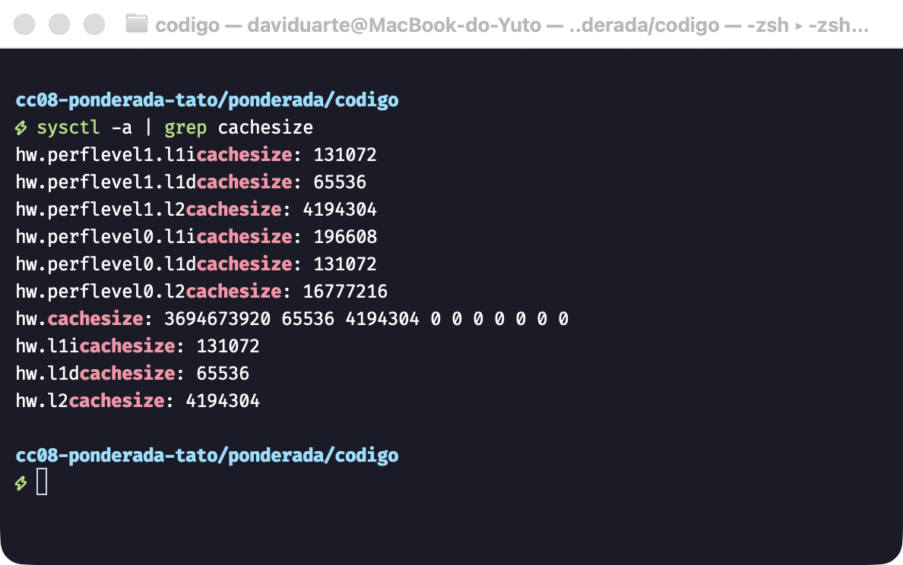
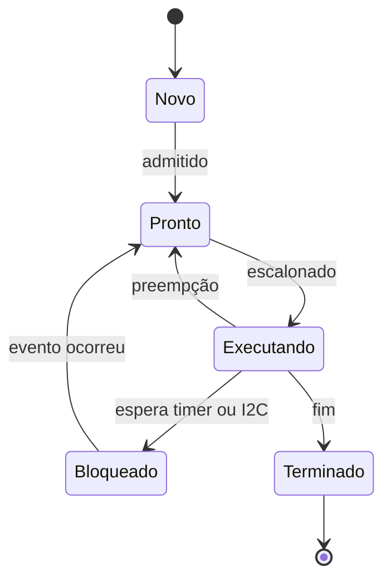
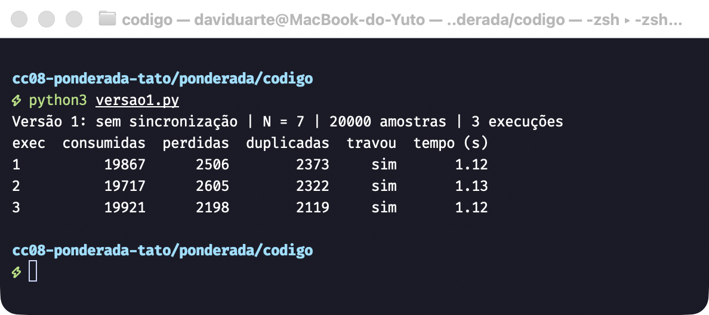
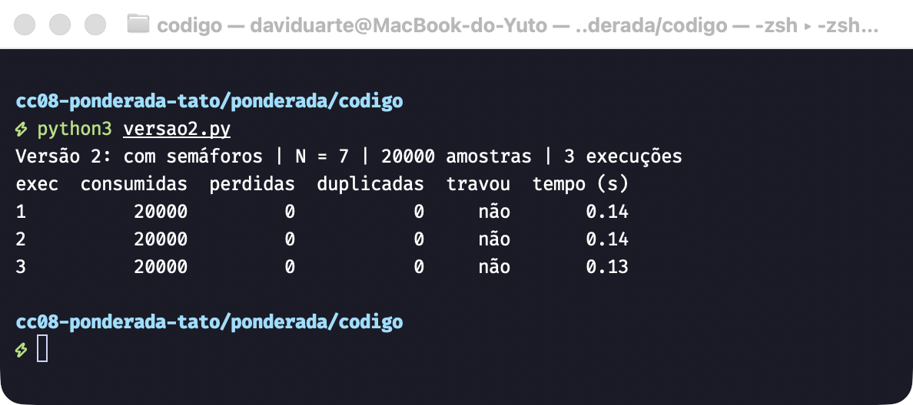
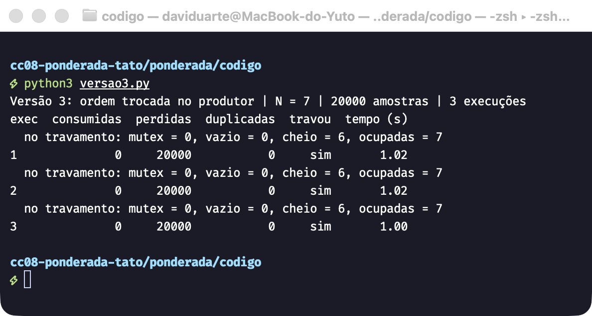
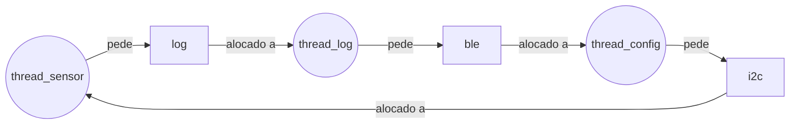
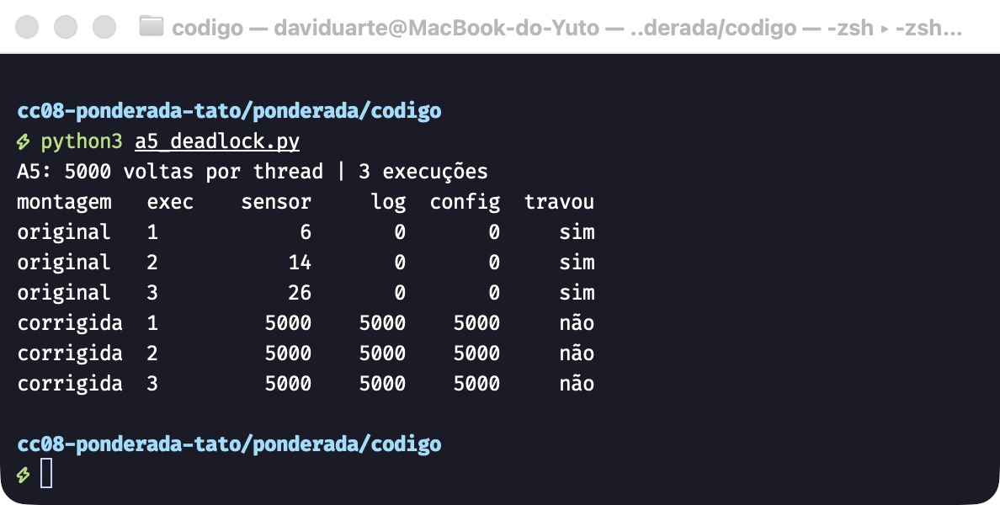

**Nome:** Davi Duarte Rodrigues | **D1 =** 4 | **D2 =** 9 | **N =** 7

# Ponderada CC08: do pipeline ao deadlock

Meus parâmetros, contando as letras de Davi (4), Duarte (6) e Rodrigues (9):

- D1 = 4, porque o primeiro nome tem 4 letras.
- D2 = 9, porque o total é 4 + 6 + 9 = 19, cujo último dígito é 9.
- IC = 100.000 + 20.000 × 9 = **280.000 instruções por amostra**.
- m = 3% + 0,5% × 4 = **5%**.
- N = 3 + (9 mod 5) = 3 + 4 = **7 posições**.

# Parte A: o problema técnico

## A1. Arquitetura e memória: qual processador vai na pulseira?

### 1. Plataforma H

```
ciclos = IC × CPI = 280.000 × 1,5 = 420.000 ciclos
tempo  = 420.000 / 48.000.000 Hz = 8,75 ms
```

Como 8,75 ms é maior que 5 ms, concluí que a Plataforma H sozinha não cumpre o requisito. Ela passa 3,75 ms do limite.

### 2. Plataforma V

```
AMAT = acerto + m × penalidade = 1 + 0,05 × 120 = 7 ciclos
CPI efetivo = 1,0 + (1,3 × 0,05 × 120) = 1,0 + 7,8 = 8,8
tempo por amostra = 280.000 × 8,8 / 1.200.000.000 Hz = 2.464.000 / 1,2 GHz = 2,053 ms
pior caso = 2,053 ms + 3 ms (sistema operacional) = 5,053 ms
```

Concluí que a Plataforma V também não cumpre o requisito. O tempo médio de CPU (2,053 ms) cabe com folga, mas o requisito vale para cada amostra. No pior caso, a plataforma passa do limite por 0,053 ms, cerca de 1%. Pelas contas, quem derruba a V é o atraso do Linux, não a velocidade do processador.

### 3. Plataforma H com DSP (Lei de Amdahl)

Fração acelerada f = 0,6 e aceleração s = 5.

```
speedup = 1 / ((1 − f) + f / s) = 1 / (0,4 + 0,6 / 5) = 1 / 0,52 = 1,923
novo tempo = 8,75 ms / 1,923 = 8,75 × 0,52 = 4,55 ms
```

Com o DSP, a Plataforma H passa a cumprir o requisito, com folga de 0,45 ms (9% do limite). A tabela do enunciado não dá atraso de sistema operacional para ela, então não somei nenhuma parcela de pior caso. Esse resultado vale dentro desse modelo, que não inclui o BLE nem as interrupções. Volto a isso no memorando.

### 4. Por que a V precisa de cache e a H funciona sem

Na V, instruções e dados dividem o caminho até uma DRAM externa de 120 ciclos: é o gargalo de Von Neumann.
Sem cache, o CPI iria para cerca de 157 (1,0 + 1,3 × 120), contra 8,8 com cache.
A H é Harvard: instruções e dados não disputam o mesmo barramento.
Sua SRAM responde em 1 ciclo, então a memória acompanha o processador.
Não há diferença de velocidade para uma cache esconder.

### 5. Evidência da minha máquina



Minha L1 é dividida. Nos núcleos de desempenho (`perflevel0`) são 192 KiB de instruções (`l1icachesize`) e 128 KiB de dados (`l1dcachesize`). Nos de eficiência (`perflevel1`) são 128 KiB e 64 KiB. A L2 é unificada, para instruções e dados: são duas, uma de 16 MiB para os núcleos de desempenho e outra de 4 MiB para os de eficiência.

**Meu computador é Von Neumann no modelo geral, com uma L1 ao estilo Harvard (o que se chama de Harvard modificada).** Justificativa: o programa e os dados ficam na mesma RAM e no mesmo espaço de endereços, e por isso é possível carregar um programa como se fosse um dado. A separação só existe na L1, para que a busca de instrução e o acesso a dados aconteçam ao mesmo tempo sem disputar a cache.

## A2. Pipeline: o loop do filtro

### 1. Dependências de dados (RAW)

- I2 (`add`) depende de I1 (`lw`), por `x5`.
- I4 (`sub`) depende de I2 (`add`), por `x6`.
- I4 (`sub`) depende de I3 (`lw`), por `x7`.
- I5 (`sw`) depende de I4 (`sub`), por `x6`.

`addi` em I6 e I7 escreve `x10` e `x11`, que I1 e I3 leram antes. Isso é leitura seguida de escrita (WAR), não RAW, e não causa bolha neste pipeline. Essa ordem importa para a questão 4.

### 2. Sem forwarding

O consumidor só lê o registrador no ID, e no mínimo no mesmo ciclo do WB do produtor, porque o banco escreve na primeira metade do ciclo e lê na segunda. `st` marca um ciclo parado.

| Instr. | 1 | 2 | 3 | 4 | 5 | 6 | 7 | 8 | 9 | 10 | 11 | 12 | 13 | 14 | 15 | 16 | 17 |
| --- | --- | --- | --- | --- | --- | --- | --- | --- | --- | --- | --- | --- | --- | --- | --- | --- | --- |
| I1 `lw x5` | IF | ID | EX | MEM | WB | | | | | | | | | | | | |
| I2 `add x6` | | IF | st | st | ID | EX | MEM | WB | | | | | | | | | |
| I3 `lw x7` | | | IF | st | st | ID | EX | MEM | WB | | | | | | | | |
| I4 `sub x6` | | | | | | IF | st | st | ID | EX | MEM | WB | | | | | |
| I5 `sw x6` | | | | | | | IF | st | st | st | st | ID | EX | MEM | WB | | |
| I6 `addi x10` | | | | | | | | | | IF | st | st | ID | EX | MEM | WB | |
| I7 `addi x11` | | | | | | | | | | | | | IF | ID | EX | MEM | WB |

**Total: 17 ciclos.** Conferência: 5 + (7 − 1) = 11 ciclos ideais, mais 6 de bolha (2 em I2, 2 em I4, por causa de I3, e 2 em I5).

A tabela tem 12 células `st`, mas isso não significa 12 bolhas. Seis são esperas pelo dado: as de I2, as de I4 e as duas últimas de I5. As outras seis são efeito cascata: I3, I6 e as duas primeiras de I5 ficam presas no IF porque a instrução da frente está parada no ID, nos mesmos ciclos.

### 3. Com forwarding

| Instr. | 1 | 2 | 3 | 4 | 5 | 6 | 7 | 8 | 9 | 10 | 11 | 12 | 13 |
| --- | --- | --- | --- | --- | --- | --- | --- | --- | --- | --- | --- | --- | --- |
| I1 `lw x5` | IF | ID | EX | MEM | WB | | | | | | | | |
| I2 `add x6` | | IF | ID | st | EX | MEM | WB | | | | | | |
| I3 `lw x7` | | | IF | st | ID | EX | MEM | WB | | | | | |
| I4 `sub x6` | | | | | IF | ID | st | EX | MEM | WB | | | |
| I5 `sw x6` | | | | | | IF | st | ID | EX | MEM | WB | | |
| I6 `addi x10` | | | | | | | | IF | ID | EX | MEM | WB | |
| I7 `addi x11` | | | | | | | | | IF | ID | EX | MEM | WB |

**Total: 13 ciclos** (11 + 2 bolhas). Das 4 células `st`, as de I2 e I4 são as bolhas, e as de I3 e I5 são o efeito cascata.

As duas bolhas que restam são de **load-use**: I1 → I2 (`x5`) e I3 → I4 (`x7`). O `lw` só tem o dado no fim do MEM, mas a instrução seguinte precisa dele no começo do EX, que acontece nesse mesmo ciclo. Forwarding não envia um dado para o passado, então é preciso esperar 1 ciclo. As dependências de `add`/`sub` (`x6`) não param nada, porque o resultado sai no fim do EX.

### 4. Reordenação sem bolhas

A ideia é subir o segundo `lw`, para que nenhuma instrução use um dado de `lw` logo na instrução seguinte.

```
1  lw   x5, 0(x10)
2  lw   x7, 0(x11)
3  add  x6, x6, x5
4  sub  x6, x6, x7
5  sw   x6, 0(x12)
6  addi x10, x10, 4
7  addi x11, x11, 4
```

| Instr. | 1 | 2 | 3 | 4 | 5 | 6 | 7 | 8 | 9 | 10 | 11 |
| --- | --- | --- | --- | --- | --- | --- | --- | --- | --- | --- | --- |
| `lw x5` | IF | ID | EX | MEM | WB | | | | | | |
| `lw x7` | | IF | ID | EX | MEM | WB | | | | | |
| `add x6` | | | IF | ID | EX | MEM | WB | | | | |
| `sub x6` | | | | IF | ID | EX | MEM | WB | | | |
| `sw x6` | | | | | IF | ID | EX | MEM | WB | | |
| `addi x10` | | | | | | IF | ID | EX | MEM | WB | |
| `addi x11` | | | | | | | IF | ID | EX | MEM | WB |

**Novo total: 11 ciclos, sem bolhas.** Cada `lw` agora tem uma instrução entre ele e quem usa seu dado, e o forwarding cobre o resto.

O resultado não muda. Os dois `lw` não dependem um do outro, o `add` ainda vem antes do `sub` e o `sw` ainda grava a soma final. Os `addi` continuam depois dos `lw`, que precisam dos ponteiros ainda sem avançar.

## A3. Processos e threads: como organizar o software

### 1. Organização proposta

Proponho separar o software assim:

- **Um processo principal, com três threads:** sensor, processamento e motor.
- **Um processo separado:** BLE.

- **Memória:** as três threads compartilham o buffer de amostras diretamente, sem cópia. O BLE só recebe e entrega dados por IPC, como uma fila, sem enxergar a memória crítica.
- **Criação e troca de contexto:** criar threads é mais barato e, na troca entre elas, o espaço de endereços continua o mesmo, o que ajuda a cumprir os 5 ms. Trocar para o processo do BLE é mais caro, mas o log não tem esse prazo, então aceito o custo.
- **Falhas:** uma falha derruba as três threads juntas, mas elas formam uma única função: sem qualquer uma delas não há alerta. Já o BLE pode cair sem levar o resto. O processo principal continua vibrando e um supervisor reinicia o BLE.

A fila entre os processos não pode bloquear: se o BLE estiver lento, o log é descartado, e o caminho crítico nunca espera o rádio.

### 2. Falha explorada no módulo BLE

- **Como thread:** o código do atacante roda no mesmo espaço de endereços. Ele pode ler e alterar as amostras e os parâmetros do filtro, ou derrubar todo o processo. Na prática, pode silenciar a vibração sem a pessoa saber.
- **Como processo separado:** a MMU impede o acesso direto à memória do processo principal. O atacante fica limitado ao que o processo BLE pode fazer, e o laço de segurança continua rodando. Para ir além, ele precisaria de uma segunda falha, no kernel ou no canal de IPC. Por isso, o processo principal também deve validar cada comando de configuração recebido.

### 3. Diagrama de estados



A thread do sensor passa a maior parte do tempo em **Bloqueado**. Ela lê uma amostra a cada 10 ms e, entre uma leitura e outra, só espera o timer e o barramento I2C. Mesmo se ela fizesse sozinha todo o trabalho da amostra (2,053 ms, da A1), ficaria pelo menos 79% do período sem usar a CPU (1 − 2,053 / 10). Como ela só lê o sensor, a parcela real é ainda maior. Bloquear também é o certo: com espera ocupada, ela gastaria CPU e bateria à toa.

## A4. Código com semáforos: o buffer entre o sensor e o motor

O código está em [`codigo/`](codigo/), em Python 3 com `threading`, e N = 7. Cada comando (`python3 versao1.py`, por exemplo) faz as 3 execuções de 20.000 amostras. Os números abaixo são os dos prints.

### Resultados

| Versão | Execução | Consumidas | Perdidas | Duplicadas | Travou? |
| --- | --- | --- | --- | --- | --- |
| 1 | 1 | 19.867 | 2.506 | 2.373 | sim |
| 1 | 2 | 19.717 | 2.605 | 2.322 | sim |
| 1 | 3 | 19.921 | 2.198 | 2.119 | sim |
| 2 | 1 | 20.000 | 0 | 0 | não |
| 2 | 2 | 20.000 | 0 | 0 | não |
| 2 | 3 | 20.000 | 0 | 0 | não |
| 3 | 1 | 0 | 20.000 | 0 | sim |
| 3 | 2 | 0 | 20.000 | 0 | sim |
| 3 | 3 | 0 | 20.000 | 0 | sim |

Como contei: perdida é um número de 0 a 19.999 que o consumidor nunca leu, e duplicada é uma leitura de um número já lido. Na versão 3, "20.000 perdidas" significa que nenhuma amostra chegou ao consumidor. O produtor só chegou a gravar 7.

### Prints







### Região crítica da versão 1

A região crítica é todo o trecho que usa dados compartilhados sem proteção, nas duas threads: testar o contador, acessar o buffer e atualizar o contador. A corrida fica mais clara na atualização:

```python
lido = estado.ocupadas      # lê
time.sleep(0)               # a outra thread pode rodar aqui
estado.ocupadas = lido + 1  # escreve (no consumidor, lido - 1)
```

Se as duas threads leem o mesmo valor, uma escrita apaga a outra. Com 3 no contador, por exemplo, o produtor grava 4 e o consumidor grava 2: o contador termina em 2, quando o certo seria 3. A partir daí, ele não representa mais o buffer:

- **Contador abaixo do real:** o produtor acha que há espaço e sobrescreve uma amostra ainda não lida. Essa amostra é **perdida**.
- **Contador acima do real:** o consumidor acha que há dado novo e lê uma posição antiga. Essa amostra é **duplicada**.

Medi entre 11% e 13% de amostras perdidas em cada execução do print. Nessa rodada as três travaram, mas não foi deadlock. Num teste à parte, com 30 execuções, 15 travaram, e em todas essas 15 o produtor já tinha terminado e o contador estava em 0: o consumidor ficou esperando amostras que nunca viriam.

Nas outras 15, as duplicatas completaram as 20.000 leituras. Considero esse o pior caso, porque o programa termina sem acusar nenhum erro. Só vi o problema porque comparei os números lidos com os gerados. Na pulseira, a pessoa receberia alertas com dados velhos sem ninguém perceber.

### O que cada semáforo garante na versão 2

- **`vazio` (começa em 7):** conta as posições livres. O produtor dorme quando o buffer está cheio, então nunca sobrescreve uma amostra não lida.
- **`cheio` (começa em 0):** conta as posições com dado. O consumidor dorme quando o buffer está vazio, então nunca lê uma amostra velha.
- **`mutex` (começa em 1):** só uma thread mexe no buffer e no contador por vez, o que elimina a corrida da versão 1.

Deixei o mesmo `time.sleep(0)` dentro da região crítica, para o teste continuar hostil. Ele não causa mais dano, porque a outra thread não consegue entrar. Nas três execuções, as 20.000 amostras foram consumidas e não encontrei nenhuma perdida ou duplicada. A espera também deixou de gastar CPU.

### O que aconteceu na versão 3

As três execuções travaram em **deadlock**. Quando o buffer enche, a sequência é esta:

1. O produtor faz `wait(mutex)` e consegue.
2. O produtor faz `wait(vazio)` e dorme, porque não há posição livre. Ele dorme **segurando o `mutex`**.
3. O consumidor faz `wait(cheio)` e consegue. Depois faz `wait(mutex)` e dorme, porque o mutex está com o produtor.
4. Só o consumidor poderia liberar `vazio`, e só o produtor poderia liberar `mutex`. Os dois esperam para sempre.

A versão 3 imprime os semáforos no momento do travamento, como aparece no print: `mutex = 0`, `vazio = 0`, `cheio = 6` e `ocupadas = 7`. `vazio = 0` prende o produtor, que está com o mutex, e `mutex = 0` prende o consumidor. `cheio` está em 6 porque o consumidor pegou uma das 7 permissões antes de dormir no mutex.

O consumidor leu 0 amostras porque, nesta máquina, o produtor sempre retoma o mutex antes de o consumidor conseguir entrar, e o buffer enche logo. Em outra máquina ele poderia ler algumas antes, mas o deadlock continuaria possível. A ordem dos `wait` faz parte da correção do programa: é preciso reservar a posição primeiro e pegar o mutex depois.

## A5. Deadlock: a pulseira congelou

### 1. Sequência e grafo de alocação

Uma sequência que leva ao deadlock:

1. `thread_sensor` faz `P(i2c)` e consegue.
2. `thread_log` faz `P(log)` e consegue.
3. `thread_config` faz `P(ble)` e consegue.
4. `thread_sensor` faz `P(log)` e bloqueia, porque `log` está com `thread_log`.
5. `thread_log` faz `P(ble)` e bloqueia, porque `ble` está com `thread_config`.
6. `thread_config` faz `P(i2c)` e bloqueia, porque `i2c` está com `thread_sensor`.



O grafo tem um ciclo, e cada recurso tem uma única instância. Por isso, o ciclo já é suficiente para haver deadlock.

### 2. As quatro condições nesse código

- **Exclusão mútua:** `i2c`, `log` e `ble` são semáforos binários, então só uma thread usa cada recurso por vez.
- **Posse e espera:** cada thread segura o primeiro recurso enquanto espera o segundo. `thread_sensor`, por exemplo, segura `i2c` enquanto pede `log`.
- **Sem preempção:** ninguém toma um semáforo de outra thread. Ele só é liberado quando quem o tem faz `V`.
- **Espera circular:** `thread_sensor` espera `thread_log`, que espera `thread_config`, que espera `thread_sensor`.

### 3. Duas correções

**Correção 1, prevenção: `thread_config` não segura dois recursos ao mesmo tempo.** Ela guarda o comando e solta o rádio antes de pedir o sensor:

```
P(ble)  recebe_comando()  V(ble)      # guarda o comando e solta o rádio
P(i2c)  ajusta_sensor()   V(i2c)      # só então mexe no sensor
```

Isso elimina a posse e espera nessa thread e quebra o ciclo. As threads que ainda seguram dois recursos sempre os pedem na mesma ordem (`i2c`, `log`, `ble`), então nenhuma espera volta para trás. Preferi isso a uma ordem global estrita, em que `thread_config` pegaria `i2c` primeiro, porque ela poderia segurar o barramento do sensor enquanto espera um comando do celular.

Para confirmar, testei as duas montagens em [`codigo/a5_deadlock.py`](codigo/a5_deadlock.py), com as três threads disputando os semáforos. A original travou nas 3 execuções, com o sensor completando só de 6 a 26 voltas. A corrigida completou as 5.000 voltas de cada thread nas 3 execuções, sem travar.



Para quem usa a pulseira, esse congelamento deixa de existir, sem reinício nem pulso de aviso. A pessoa não percebe nenhuma mudança. O custo fica com a equipe, que precisa reescrever e testar. No Dilema 1, são 2 meses.

**Correção 2, detecção e recuperação: watchdog.** A thread do sensor avisa um temporizador de hardware a cada ciclo. Se o aviso parar, o temporizador reinicia a pulseira. O deadlock continua podendo acontecer, mas deixa de ser permanente.

Para quem usa a pulseira, o congelamento vira um buraco de cerca de 4 segundos sem vibração, avisado por um pulso longo, e a pessoa não precisa mais desligar e ligar. Enquanto dura, ela anda sem proteção e precisa saber que o pulso significa "pare".

# Parte B: a decisão do CTO

**Dilema escolhido: 2, qual processador vai para a produção.**

**Para:** Conselho da Tato | **De:** Davi Duarte Rodrigues, CTO

**Decisão.** Vamos produzir com a Plataforma H com DSP, a R$ 37 por unidade.

**Por quê.** Pelo modelo do enunciado, é a única opção que cumpre os 5 ms por amostra: 4,55 ms, com 0,45 ms de folga. Sem o DSP, a H leva 8,75 ms, então os R$ 15 são obrigatórios. A Plataforma V é mais rápida na média (2,05 ms), mas o Linux pode somar até 3 ms e levá-la a 5,05 ms. Parecem só 0,05 ms a mais, mas o número pesou porque a promessa é "cada amostra", não a média. Atrasar é deixar uma pessoa andar sem saber do poste à frente. A V ainda custa R$ 33 a mais por unidade: R$ 66 mil, supondo um lote de 2.000 unidades, número que tomei do Dilema 1 como referência. Como os 4,55 ms não incluem o BLE nem as interrupções, calculei quanto cabe: a folga equivale a 14.400 instruções por amostra durante o filtro (0,45 ms × 48 MHz / 1,5), e o restante do BLE roda nos 5,45 ms livres de cada período de 10 ms.

**Do que abro mão.** Da atualização pela internet. Corrigir o firmware passa a exigir cabo e assistência técnica. Quem paga é o cliente, que fica sem a pulseira e, sendo uma pessoa com deficiência visual, tem mais dificuldade para ir até lá. A empresa paga a logística. Também abro mão de espaço para crescer: a folga só comporta até cerca de 307 mil instruções por amostra (hoje são 280 mil).

**Impacto e segurança.** Para quem usa, o tempo de resposta fica mais previsível, sem um sistema operacional interrompendo a tarefa. A superfície de ataque também é menor que a de um Linux completo. O maior risco é outro: sem sistema operacional, não há processo separado para isolar o BLE, como propus na A3 para a V. Uma falha explorada nele pode atingir o laço de segurança e silenciar a vibração, e a correção só chega quando cada pulseira passar pela assistência, o que leva semanas. Aceito esse risco porque a alternativa já não cumpre o requisito principal. Para reduzi-lo, o BLE só vai enviar log e aceitar uma lista pequena de comandos validados, e um watchdog de hardware reinicia a pulseira se ela travar. O watchdog não cobre vibração errada por memória corrompida: esse é o risco que assumo nesta decisão.

**O que me faria mudar de ideia.** A H cai se o BLE e as interrupções precisarem de mais de 14.400 instruções por amostra durante o filtro. Nesse caso, volto ao conselho com o custo de reduzir instruções ou de adaptar a V. Mudo para a V se dois fatos se confirmarem: atraso do Linux de no máximo 2,9 ms no pior caso (o limite é 5 − 2,05) e custo previsto de assistência acima de R$ 33 por unidade ao longo da vida do produto.
